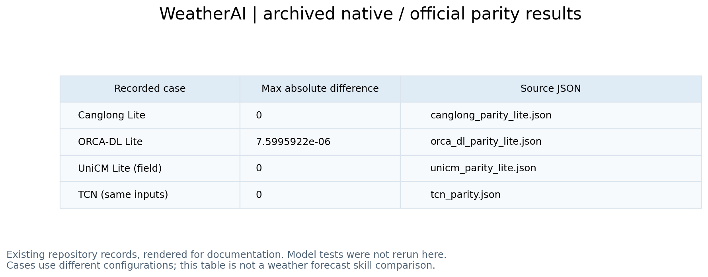

<div align="center">


**English** · [简体中文](README_zh.md) · [日本語](README_ja.md)

[](LICENSE)
[](pyproject.toml)
[](https://pytorch.org)
[](docs/models/neuralgcm.md)
[](#model-zoo)
[](https://huggingface.co/spaces/LonghaoWang/weatherai-graphcast-smoke)
[](https://huggingface.co/LonghaoWang/WeatherAI)
[](https://github.com/GISWLH/WeatherAI/stargazers)

</div>

**WeatherAI** re-implements the AI weather and climate models published in *Nature*, *Science* and their sister
journals as plain, readable PyTorch `nn.Module`s, and checks every port against the authors' own code.
Load the official weights, compare with the original, fine-tune, or start from a Lite config that runs on a laptop.

## ✨ Highlights

- 🧩 **20 models, one library** — Pangu, GraphCast, Aurora, GenCast, NeuralGCM, FuXi-S2S, CAS-Canglong and more, all
  with the same `import` style and plain tensors in / tensors out. No per-model environments to juggle.
- 🔀 **Multi-framework** — native PyTorch throughout; official **JAX** code is kept where it matters (NeuralGCM training and
  precipitation) and as the reference for GraphCast, GenCast and WeatherNext; **ONNX**-only releases (FuXi-ENS, FuXi-S2S)
  are rebuilt as PyTorch modules. Runs on CPU and **CUDA** GPUs.
- ✅ **Verified, not just rewritten** — official checkpoints strict-load for 14 models, and outputs match the official
  implementation (often bit-for-bit). Every claim has a script and a JSON result; GPU runs are tested on an NVIDIA
  Blackwell GPU through a Hugging Face ZeroGPU Space.
- 🪶 **Full size and Lite** — the paper-size network for real experiments, plus Lite configs (same code, small grid) for 15
  models that train on a laptop CPU or a single small GPU.

## 🚀 Quick start

```bash
pip install git+https://github.com/GISWLH/WeatherAI.git      # or: git clone ... && pip install -e ".[dev]"
```

```python
import torch
from weatherai.models import Canglong_lite, GraphCast_lite, Aurora_small

sst  = Canglong_lite()(torch.randn(1, 8, 8, 32, 64))    # 3-month SST outlook -> (1, 1, 3, 32, 64)
step = GraphCast_lite()(torch.randn(1, 4, 32, 64))      # one 6-hour step on a tiny icosahedral mesh
aurora = Aurora_small(pretrained=True)                  # official weights (~450 MB), strict-loaded into native PyTorch
```

<a id="model-zoo"></a>
## 🗺️ Model zoo

🔓 official weights load · 🎯 matches the official code · ⚡ tested on a CUDA GPU · 🪶 Lite config · 🆕 new.
Each **docs** link opens a one-page summary: usage, what was verified, and what was not.

### 🌍 Global medium-range forecasting

| Model | Import | Notes |
|-------|--------|-------|
| **Pangu-Weather** | `from weatherai.models import Pangu, Pangu_lite` | 3-D Earth-specific transformer · *Nature* 2023 · [paper](https://doi.org/10.1038/s41586-023-06185-3) · [docs](docs/models/pangu.md) · 🪶 |
| **FuXi** | `from weatherai.models import FuXi` | Cube embedding + Swin-V2 U-Transformer · *npj Clim. Atmos. Sci.* 2023 · [paper](https://doi.org/10.1038/s41612-023-00512-1) · [docs](docs/models/fuxi.md) |
| **FengWu** | `from weatherai.models import FengWu, FengWu_lite` | Multi-modal encode–fuse–decode · *Commun. Earth Environ.* 2025 · [paper](https://doi.org/10.1038/s43247-025-02502-y) · [docs](docs/models/fengwu.md) · 🪶 |
| **GraphCast** | `from weatherai.models import GraphCast, GraphCast_lite` | Grid ↔ icosahedral-mesh GNN, stage-wise parity vs JAX and PhysicsNeMo · *Science* 2023 · [paper](https://doi.org/10.1126/science.adi2336) · [docs](docs/models/graphcast.md) · 🎯 ⚡ 🪶 |
| **Aurora** | `from weatherai.models import Aurora, Aurora_lite, Aurora_small` | Perceiver + Swin-3D foundation model · *Nature* 2025 · [paper](https://doi.org/10.1038/s41586-025-09005-y) · [docs](docs/models/aurora.md) · 🔓 🎯 ⚡ 🪶 |
| **NeuralGCM** | `from weatherai.models.neuralgcm import NeuralGCMLearnedComponents, train` | Differentiable dynamical core + learned physics; training in JAX · *Nature* 2024 · [paper](https://doi.org/10.1038/s41586-024-07744-y) · [docs](docs/models/neuralgcm.md) · 🔓 🎯 ⚡ 🪶 |
| **Aardvark Weather** | `from weatherai.models.aardvark import AardvarkE2E, load_official_encoder` | End-to-end forecasting from raw observations · *Nature* 2025 · [paper](https://doi.org/10.1038/s41586-025-08897-0) · [docs](docs/models/aardvark.md) · 🔓 🎯 ⚡ 🪶 |

### 🎲 Ensemble & generative

| Model | Import | Notes |
|-------|--------|-------|
| **GenCast** | `from weatherai.models.gencast import GenCast_lite, GenCastDenoiser_from_official` | Diffusion ensemble: native denoiser + DPM-Solver++ sampler · *Nature* 2025 · [paper](https://doi.org/10.1038/s41586-024-08252-9) · [docs](docs/models/gencast.md) · 🔓 🎯 ⚡ 🪶 |
| **FuXi-ENS** | `from weatherai.models.fuxi_ens import FuXiENS, FuXiENS_lite, load_official` | 2.5 B-parameter latent-noise ensemble, rebuilt from ONNX · *Sci. Adv.* 2025 · [paper](https://doi.org/10.1126/sciadv.adu2854) · [docs](docs/models/fuxi_ens.md) · 🔓 🎯 ⚡ 🪶 |
| **ArchesWeather / Gen** | `from weatherai.models.arches import ArchesWeather_lite, ArchesWeatherGen_lite, convert` | 3-D attention forecaster + flow-matching generator · *Sci. Adv.* 2026 · [paper](https://doi.org/10.1126/sciadv.adx2372) · [docs](docs/models/arches.md) · 🔓 🎯 ⚡ 🪶 |
| **NeuralGCM precipitation** | `from weatherai.models.neuralgcm import precip` | Stochastic precipitation checkpoints + trainable loss (JAX) · *Sci. Adv.* 2026 · [paper](https://doi.org/10.1126/sciadv.adv6891) · [docs](docs/models/neuralgcm_precip.md) · 🔓 ⚡ |

### 🌊 Sub-seasonal to seasonal, climate & ocean

| Model | Import | Notes |
|-------|--------|-------|
| **CAS-Canglong** 🆕 | `from weatherai.models.canglong import Canglong, Canglong_lite, load_official` | 3-D Earth-specific transformer for 1–3-month global SST · *Adv. Sci.* · [paper](https://doi.org/10.1002/advs.78271) · [docs](docs/models/canglong.md) · 🔓 🎯 ⚡ 🪶 |
| **FuXi-S2S** | `from weatherai.models.fuxi_s2s.convert import load_official` | Sub-seasonal Swin-V2 ensemble (1.04 B), rebuilt from ONNX · *Nat. Commun.* 2024 · [paper](https://doi.org/10.1038/s41467-024-50714-1) · [docs](docs/models/fuxi_s2s.md) · 🔓 🎯 ⚡ 🪶 |
| **UniCM** | `from weatherai.models.unicm import UniCM, UniCMConfig` | Coupled climate-mode transformer (ENSO and other modes) · *Nat. Mach. Intell.* 2026 · [paper](https://doi.org/10.1038/s42256-026-01245-5) · [docs](docs/models/unicm.md) · 🎯 ⚡ 🪶 |
| **ORCA-DL** | `from weatherai.models.orca_dl import ORCADL, load_official` | Global 3-D ocean forecaster, monthly steps · *Sci. Adv.* 2025 · [paper](https://doi.org/10.1126/sciadv.adu2488) · [docs](docs/models/orca_dl.md) · 🔓 🎯 ⚡ |
| **ACE2-ERA5** | `from weatherai.models.ace2 import ACE2, load_official` | Spherical Fourier neural operator climate emulator with conservation · *npj Clim. Atmos. Sci.* 2025 · [paper](https://doi.org/10.1038/s41612-025-01090-0) · [docs](docs/models/ace2.md) · 🔓 🎯 ⚡ |
| **GenFocal** | `from weatherai.models.genfocal import GenFocalNet, reflow_loss, sample_flow` | Generative debiasing flow (lite core) · *Nat. Mach. Intell.* 2026 · [paper](https://doi.org/10.1038/s42256-026-01308-7) · [docs](docs/models/genfocal.md) · 🎯 ⚡ 🪶 |

### 🌀 Regional & tropical cyclones

| Model | Import | Notes |
|-------|--------|-------|
| **StormCast** | `from weatherai.models.stormcast import StormCast, StormCast_lite, load_official` | 3 km regional (HRRR) regression U-Net + EDM diffusion · *Sci. Adv.* 2026 · [paper](https://doi.org/10.1126/sciadv.adv0423) · [docs](docs/models/stormcast.md) · 🔓 🎯 ⚡ 🪶 |
| **TropiCycloneNet** | `from weatherai.models.tropicyclonenet import TCNM, load_official` | Multimodal tropical-cyclone track + intensity · *Nat. Commun.* 2025 · [paper](https://doi.org/10.1038/s41467-025-61087-4) · [docs](docs/models/tropicyclonenet.md) · 🔓 🎯 ⚡ |
| **WeatherNext Cyclones** | `from weatherai.models.weathernext_cyclones import WeatherNextCyclonesNet_from_official, WeatherNextCyclonesNative_lite` | Functional generative network for cyclones (Mini) · *Nature* 2026 · [paper](https://doi.org/10.1038/s41586-026-10953-2) · [docs](docs/models/weathernext_cyclones.md) · 🔓 🎯 ⚡ 🪶 |

More: [all model pages](docs/models/README.md) · [verification log](docs/model_status.md) · [roadmap & planned models](docs/roadmap.md)

## 🔬 What "verified" means

For each port, the unchanged official code (PyTorch, JAX or onnxruntime) and the native module receive the same weights
and inputs, and their outputs are compared; the scripts are in [`scripts/`](scripts) and the numbers in
[`docs/results/`](docs/results). GPU runs use [`scripts/gpu_smoke.py`](scripts/gpu_smoke.py) on the Hugging Face Space.
These are implementation checks, not forecast-skill claims; each model page lists what was **not** verified.

## 🤗 Hugging Face

- **Space** — [LonghaoWang/weatherai-graphcast-smoke](https://huggingface.co/spaces/LonghaoWang/weatherai-graphcast-smoke): ZeroGPU smoke tests for every model.
- **Hub** — [LonghaoWang/WeatherAI](https://huggingface.co/LonghaoWang/WeatherAI): model card and model pages, synced from this repository by [`.github/workflows/sync_hf.yml`](.github/workflows/sync_hf.yml).
- Official weights stay with their authors and keep their licences (Apache-2.0, MIT, CC-BY, CC-BY-NC(-ND), …): WeatherAI downloads them on demand and never redistributes them.

## 🧪 Tests

```bash
pip install -e ".[dev]"
pytest tests/models -q          # unit tests; parity references are stored under tests/models/*/data
```

## 📖 Citation

Please cite the original paper of each model you use (linked above) and, if WeatherAI helped, this repository
([`CITATION.cff`](CITATION.cff)):

```bibtex
@software{wang_weatherai,
  author = {Wang, Longhao},
  title  = {{WeatherAI}: a PyTorch model zoo of AI weather and climate models},
  url    = {https://github.com/GISWLH/WeatherAI},
  year   = {2026}
}
```

## 🤝 Contributing

Issues and pull requests are welcome. A new model is accepted when it comes with a native module, a Lite config, a parity
script against the official code, unit tests and a page in `docs/models/`. If WeatherAI saves you time, a ⭐ helps others find it.

## License

[MIT](LICENSE) — Copyright (c) 2026 Longhao Wang (GISWLH); adapted code from [WeatherLearn](https://github.com/lizhuoq/WeatherLearn)
(MIT), see [NOTICE](NOTICE). Model weights are under their authors' licences. Research and educational code: forecast skill
depends on data, training and weights, and nothing here replaces an operational forecasting system.

<!-- readme-visual-refresh:artwork-source -->
[Editable banner artwork · Excalidraw](assets/readme/banner.excalidraw)
<!-- /readme-visual-refresh:artwork-source -->


<!-- readme-visual-refresh:execution -->
## Demonstration captured on EHPC · 17 October 2026



New visualization of the repository's existing parity-check JSON. This displays a recorded historical check; it is not a new training or model-validation run.

[Execution record and checksums](assets/readme/execution-record.json).
<!-- /readme-visual-refresh:execution -->
