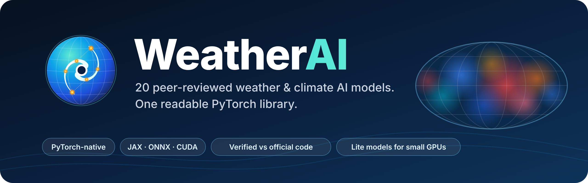

**2026-10-19 官方实现更新：** [三篇论文与执行报告](docs/research_20261019.md)。主体 `GenFocal`、`PBC`、`Translocation` 已改用固定版本的作者代码；GenFocal/GraphCast 自动获取官方预训练权重，PBC 使用作者历史数据拟合流程（没有通用权重）。自写实验版本仅保留在 lite 名下，WeatherPre 默认加载官方入口。

<div align="center">



[English](README.md) · **简体中文** · [日本語](README_ja.md)

[](LICENSE)
[](pyproject.toml)
[](https://pytorch.org)
[](docs/models/neuralgcm.md)
[](#model-zoo)
[](https://huggingface.co/spaces/LonghaoWang/weatherai-graphcast-smoke)
[](https://huggingface.co/LonghaoWang/WeatherAI)
[](https://github.com/GISWLH/WeatherAI/stargazers)

</div>

**WeatherAI** 将发表在 *Nature*、*Science* 及其子刊上的天气与气候 AI 模型，重写为清晰易读的 PyTorch `nn.Module`，并逐一与作者的官方代码做数值核对。你可以直接加载官方权重、与原版对比、微调，或从能在笔记本电脑上运行的 Lite 配置起步。

## ✨ 亮点

- 🧩 **20 个模型，一个库** —— Pangu、GraphCast、Aurora、GenCast、NeuralGCM、FuXi-S2S、CAS-Canglong 等，统一的 `import` 方式，张量进、张量出，无需为每个模型单独配置环境。
- 🔀 **多框架支持** —— 全部提供原生 PyTorch 实现；在关键处保留官方 **JAX** 代码（NeuralGCM 训练与降水模型），并作为 GraphCast、GenCast、WeatherNext 的数值参照；仅发布 **ONNX** 的模型（FuXi-ENS、FuXi-S2S）被还原为 PyTorch 模块。CPU 与 **CUDA** GPU 均可运行。
- ✅ **经过验证，而不只是重写** —— 14 个模型可严格（strict）加载官方权重，输出与官方实现一致（多数逐位相同）。每条结论都有对应脚本与 JSON 结果；GPU 运行在 Hugging Face ZeroGPU Space 的 NVIDIA Blackwell GPU 上测试。
- 🪶 **完整版与 Lite 版** —— 论文规模的网络用于正式实验；另有 15 个模型提供 Lite 配置（同一套代码、小网格），可在笔记本 CPU 或单张小显存 GPU 上训练。

## 🚀 快速开始

```bash
pip install git+https://github.com/GISWLH/WeatherAI.git      # 或：git clone ... && pip install -e ".[dev]"
```

```python
import torch
from weatherai.models import Canglong_lite, GraphCast_lite, Aurora_small

sst  = Canglong_lite()(torch.randn(1, 8, 8, 32, 64))    # 未来 3 个月 SST -> (1, 1, 3, 32, 64)
step = GraphCast_lite()(torch.randn(1, 4, 32, 64))      # 在小型二十面体网格上预报一步（6 小时）
aurora = Aurora_small(pretrained=True)                  # 官方权重（约 450 MB），严格加载到原生 PyTorch 模型
```

<a id="model-zoo"></a>
## 🗺️ 模型库

🔓 可加载官方权重 · 🎯 与官方代码数值一致 · ⚡ 已在 CUDA GPU 上测试 · 🪶 提供 Lite 配置 · 🆕 新增。每个 **docs** 链接是一页简介：用法、已验证内容与未验证内容（英文）。

### 🌍 全球中期天气预报

| Model | Import | Notes |
|-------|--------|-------|
| **Pangu-Weather** | `from weatherai.models import Pangu, Pangu_lite` | 三维地球特定 Transformer · *Nature* 2023 · [论文](https://doi.org/10.1038/s41586-023-06185-3) · [docs](docs/models/pangu.md) · 🪶 |
| **FuXi** | `from weatherai.models import FuXi` | 立方体嵌入 + Swin-V2 U-Transformer · *npj Clim. Atmos. Sci.* 2023 · [论文](https://doi.org/10.1038/s41612-023-00512-1) · [docs](docs/models/fuxi.md) |
| **FengWu** | `from weatherai.models import FengWu, FengWu_lite` | 多模态编码–融合–解码 · *Commun. Earth Environ.* 2025 · [论文](https://doi.org/10.1038/s43247-025-02502-y) · [docs](docs/models/fengwu.md) · 🪶 |
| **GraphCast** | `from weatherai.models import GraphCast, GraphCast_lite` | 网格 ↔ 二十面体网格 GNN，与 JAX / PhysicsNeMo 分阶段对齐 · *Science* 2023 · [论文](https://doi.org/10.1126/science.adi2336) · [docs](docs/models/graphcast.md) · 🎯 ⚡ 🪶 |
| **Aurora** | `from weatherai.models import Aurora, Aurora_lite, Aurora_small` | Perceiver + Swin-3D 基础模型 · *Nature* 2025 · [论文](https://doi.org/10.1038/s41586-025-09005-y) · [docs](docs/models/aurora.md) · 🔓 🎯 ⚡ 🪶 |
| **NeuralGCM** | `from weatherai.models.neuralgcm import NeuralGCMLearnedComponents, train` | 可微动力核心 + 学习型物理；JAX 训练 · *Nature* 2024 · [论文](https://doi.org/10.1038/s41586-024-07744-y) · [docs](docs/models/neuralgcm.md) · 🔓 🎯 ⚡ 🪶 |
| **Aardvark Weather** | `from weatherai.models.aardvark import AardvarkE2E, load_official_encoder` | 从原始观测端到端预报 · *Nature* 2025 · [论文](https://doi.org/10.1038/s41586-025-08897-0) · [docs](docs/models/aardvark.md) · 🔓 🎯 ⚡ 🪶 |

### 🎲 集合与生成式模型

| Model | Import | Notes |
|-------|--------|-------|
| **GenCast** | `from weatherai.models.gencast import GenCast_lite, GenCastDenoiser_from_official` | 扩散集合预报：原生去噪器 + DPM-Solver++ 采样器 · *Nature* 2025 · [论文](https://doi.org/10.1038/s41586-024-08252-9) · [docs](docs/models/gencast.md) · 🔓 🎯 ⚡ 🪶 |
| **FuXi-ENS** | `from weatherai.models.fuxi_ens import FuXiENS, FuXiENS_lite, load_official` | 25 亿参数潜变量噪声集合模型，由 ONNX 还原 · *Sci. Adv.* 2025 · [论文](https://doi.org/10.1126/sciadv.adu2854) · [docs](docs/models/fuxi_ens.md) · 🔓 🎯 ⚡ 🪶 |
| **ArchesWeather / Gen** | `from weatherai.models.arches import ArchesWeather_lite, ArchesWeatherGen_lite, convert` | 三维注意力预报器 + 流匹配生成器 · *Sci. Adv.* 2026 · [论文](https://doi.org/10.1126/sciadv.adx2372) · [docs](docs/models/arches.md) · 🔓 🎯 ⚡ 🪶 |
| **NeuralGCM precipitation** | `from weatherai.models.neuralgcm import precip` | 随机降水检查点 + 可训练损失（JAX） · *Sci. Adv.* 2026 · [论文](https://doi.org/10.1126/sciadv.adv6891) · [docs](docs/models/neuralgcm_precip.md) · 🔓 ⚡ |

### 🌊 次季节–季节、气候与海洋

| Model | Import | Notes |
|-------|--------|-------|
| **CAS-Canglong** 🆕 | `from weatherai.models.canglong import Canglong, Canglong_lite, load_official` | 三维地球特定 Transformer，预测未来 1–3 个月全球海表温度 · *Adv. Sci.* · [论文](https://doi.org/10.1002/advs.78271) · [docs](docs/models/canglong.md) · 🔓 🎯 ⚡ 🪶 |
| **FuXi-S2S** | `from weatherai.models.fuxi_s2s.convert import load_official` | 次季节 Swin-V2 集合模型（10.4 亿参数），由 ONNX 还原 · *Nat. Commun.* 2024 · [论文](https://doi.org/10.1038/s41467-024-50714-1) · [docs](docs/models/fuxi_s2s.md) · 🔓 🎯 ⚡ 🪶 |
| **UniCM** | `from weatherai.models.unicm import UniCM, UniCMConfig` | 耦合气候模态 Transformer（ENSO 等） · *Nat. Mach. Intell.* 2026 · [论文](https://doi.org/10.1038/s42256-026-01245-5) · [docs](docs/models/unicm.md) · 🎯 ⚡ 🪶 |
| **ORCA-DL** | `from weatherai.models.orca_dl import ORCADL, load_official` | 全球三维海洋预报，月尺度步长 · *Sci. Adv.* 2025 · [论文](https://doi.org/10.1126/sciadv.adu2488) · [docs](docs/models/orca_dl.md) · 🔓 🎯 ⚡ |
| **ACE2-ERA5** | `from weatherai.models.ace2 import ACE2, load_official` | 带守恒约束的球面傅里叶神经算子气候模拟器 · *npj Clim. Atmos. Sci.* 2025 · [论文](https://doi.org/10.1038/s41612-025-01090-0) · [docs](docs/models/ace2.md) · 🔓 🎯 ⚡ |
| **GenFocal** | `from weatherai import GenFocal, GenFocal_lite` | 生成式偏差订正流模型（lite 核心） · *Nat. Mach. Intell.* 2026 · [论文](https://doi.org/10.1038/s42256-026-01308-7) · [docs](docs/models/genfocal.md) · 🎯 ⚡ 🪶 |

### 🌀 区域与热带气旋

| Model | Import | Notes |
|-------|--------|-------|
| **StormCast** | `from weatherai.models.stormcast import StormCast, StormCast_lite, load_official` | 3 km 区域（HRRR）回归 U-Net + EDM 扩散 · *Sci. Adv.* 2026 · [论文](https://doi.org/10.1126/sciadv.adv0423) · [docs](docs/models/stormcast.md) · 🔓 🎯 ⚡ 🪶 |
| **TropiCycloneNet** | `from weatherai.models.tropicyclonenet import TCNM, load_official` | 多模态热带气旋路径 + 强度 · *Nat. Commun.* 2025 · [论文](https://doi.org/10.1038/s41467-025-61087-4) · [docs](docs/models/tropicyclonenet.md) · 🔓 🎯 ⚡ |
| **WeatherNext Cyclones** | `from weatherai.models.weathernext_cyclones import WeatherNextCyclonesNet_from_official, WeatherNextCyclonesNative_lite` | 面向气旋的函数生成网络（Mini） · *Nature* 2026 · [论文](https://doi.org/10.1038/s41586-026-10953-2) · [docs](docs/models/weathernext_cyclones.md) · 🔓 🎯 ⚡ 🪶 |

更多：[全部模型页面](docs/models/README.md) · [验证日志](docs/model_status.md) · [路线图与计划模型](docs/roadmap.md)

## 🔬 “已验证”指什么

对每个移植模型，未经修改的官方代码（PyTorch、JAX 或 onnxruntime）与原生模块使用相同的权重和输入，比较二者输出；脚本位于 [`scripts/`](scripts)，数值结果位于 [`docs/results/`](docs/results)。GPU 测试在 Hugging Face Space 上运行 [`scripts/gpu_smoke.py`](scripts/gpu_smoke.py)。这些是实现层面的检查，而非预报技巧的结论；每个模型页面都列出了**未**验证的内容。

## 🤗 Hugging Face

- **Space** —— [LonghaoWang/weatherai-graphcast-smoke](https://huggingface.co/spaces/LonghaoWang/weatherai-graphcast-smoke)：所有模型的 ZeroGPU 冒烟测试。
- **Hub** —— [LonghaoWang/WeatherAI](https://huggingface.co/LonghaoWang/WeatherAI)：模型卡与各模型页面，由 [`.github/workflows/sync_hf.yml`](.github/workflows/sync_hf.yml) 从本仓库自动同步。
- 官方权重归原作者所有并保留其许可证（Apache-2.0、MIT、CC-BY、CC-BY-NC(-ND) 等）：WeatherAI 按需下载，从不再分发。

## 🧪 测试

```bash
pip install -e ".[dev]"
pytest tests/models -q          # 单元测试；数值参照存放在 tests/models/*/data
```

## 📖 引用

请引用你所使用模型的原始论文（见上表链接）；如果 WeatherAI 对你有帮助，也请引用本仓库（[`CITATION.cff`](CITATION.cff)）：

```bibtex
@software{wang_weatherai,
  author = {Wang, Longhao},
  title  = {{WeatherAI}: a PyTorch model zoo of AI weather and climate models},
  url    = {https://github.com/GISWLH/WeatherAI},
  year   = {2026}
}
```

## 🤝 参与贡献

欢迎提交 Issue 和 Pull Request。新增模型需要包含：原生模块、Lite 配置、与官方代码对比的数值校验脚本、单元测试，以及 `docs/models/` 下的说明页面。如果 WeatherAI 为你节省了时间，欢迎点一个 ⭐，让更多人看到它。

## 许可证

[MIT](LICENSE) —— Copyright (c) 2026 Longhao Wang (GISWLH)；部分代码改编自 [WeatherLearn](https://github.com/lizhuoq/WeatherLearn)（MIT），详见 [NOTICE](NOTICE)。模型权重遵循各自作者的许可证。本仓库为科研与教学代码：预报技巧取决于数据、训练与权重，不能替代业务预报系统。
